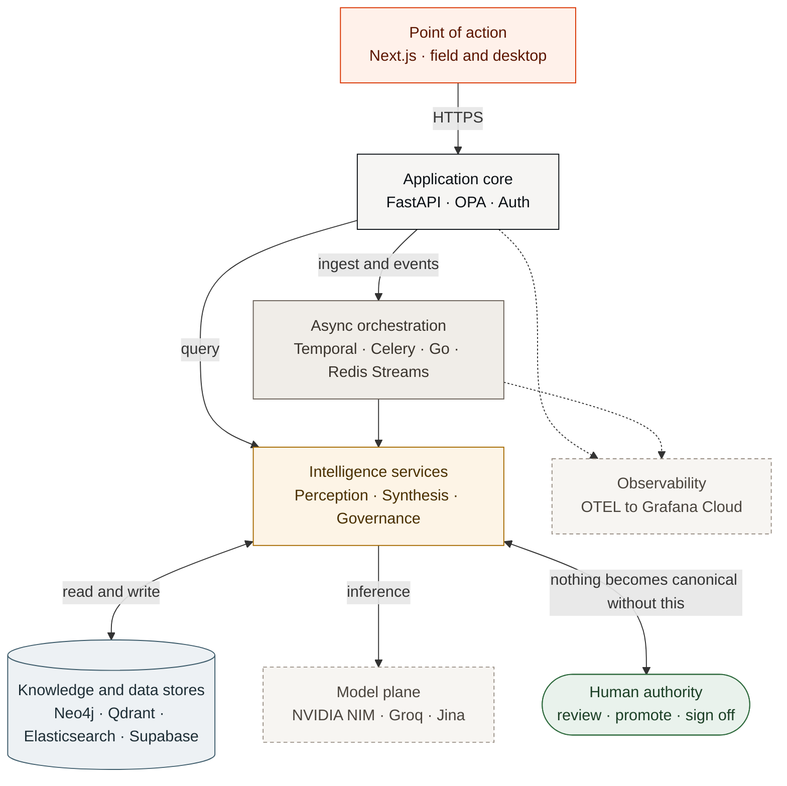

<div align="center">
</div>

<div align="center">

[Live Demo](https://kairos.deterium.xyz) · [Solution](./docs/ARCHITECTURE.md) · [Demo Video](https://drive.google.com/file/d/18ZO95MckNtESg-Z2ruRBNnKq6JyB57rP/view) · [Documentation](./docs/)

**Kairos turns a plant's scattered maintenance records and documents into cited answers, early warnings and pre-job briefs, so teams make repair and safety decisions on evidence instead of memory.**

A 13-layer platform organised into five planes: **perception, knowledge, governance, retrieval, and delivery**. A FastAPI core orchestrates five datastores, durable Temporal workflows, Celery workers, and Go OT connectors, with a Next.js interface on top.


</div>

---

## Table of Contents

- [Overview](#overview)
- [How It Works](#how-it-works)
- [Key Capabilities](#key-capabilities)
- [Tech Stack](#tech-stack)
- [Built on NVIDIA and Nebius](#built-on-nvidia-and-nebius)
- [Quick Start](#quick-start)
- [Supply-Chain Security](#supply-chain-security)
- [Repository Layout](#repository-layout)
- [Changes During the Hackathon](#changes-during-the-hackathon)
- [Feedback on Nebius and NVIDIA](#feedback-on-nebius-and-nvidia)
- [License](#license)

---

## Overview

Asset-intensive facilities, such as refineries, plants, pipelines, and power stations, run on knowledge scattered across disconnected systems. P&IDs live in one archive, maintenance history in another, standard operating procedures in a third, inspection records and regulatory filings elsewhere again. A technician standing in front of a failing pump cannot see that the same seal failed twice before, that the OEM revised the spec eighteen months ago, or that an isolation valve is overdue for inspection. The most dangerous gaps are the ones nobody knows to query, and the people who hold that context in their heads are retiring faster than they are being replaced.

**Kairos** turns that fragmented, tribal knowledge into a single **governed, temporal knowledge graph** and delivers the right information to the right person at the exact moment it is needed, doing so *proactively* with a source citation behind every claim. It ingests heterogeneous documents, extracts and links their entities, records how every fact changes over time, and surfaces answers, briefs, root-cause analyses, and compliance evidence on any device.

Three principles run through the entire platform:

> **Never assert without provenance. Never auto-promote unverified input. Refuse rather than hedge on a safety-critical question.**

These principles are enforced in the data model (every fact is an edge that carries its own authority and verification status), in the ingestion pipeline (low-confidence extractions are quarantined for a human, never silently trusted), and in the copilot (safety-critical queries return an explicit refusal card instead of a plausible guess).

## How It Works

At its core Kairos is a pipeline: raw industrial artifacts go in one end, and governed, cited, point-of-action intelligence comes out the other. Between them sits a knowledge graph that remembers not just *what* is true but *when* it was true and *how sure* we are.



1. **Ingest & perceive.** Documents, events, and voice notes enter through one gate. OCR and NER lift entities (including equipment tags, process parameters, regulatory clauses, people, and dates) out of unstructured text; P&ID drawings are parsed into a connected topology. Files are stored byte-for-byte in an immutable, SHA-256-deduplicated vault.
2. **Link into the graph.** Extracted facts become **edges** in a temporal knowledge graph. Each edge carries six governance properties (validity window, authority level, source document, confidence, verification status) so the graph can answer *what was known on any past date* and show how a fact was later superseded.
3. **Govern.** Nothing unverified reaches an operator by accident. Contradictions surface as conflicts (administrative ones resolve in-app; engineering ones route through Management of Change); low-confidence extractions sit in a one-way quarantine that only a human can promote; an SPC circuit breaker halts ingestion for an asset class whose override rate spikes; a model gate blocks extraction models that fail a precision/recall bar.
4. **Retrieve & deliver.** The copilot answers questions with hybrid retrieval (graph + vector + exact) and mandatory citations, refusing outright on safety-critical parameters. Operational events assemble **proactive briefs** — governed by an EEMUA-191 push ceiling so operators are never flooded — and everything reaches the field on a mobile-first, offline-capable interface built from the same component set as the desktop workspace.

For the full design, including the 13-layer breakdown, knowledge-graph mechanics, OT virtualization, and the dual-track governance model, see **[docs/ARCHITECTURE.md](./docs/ARCHITECTURE.md)**.

## Key Capabilities

- **Universal document ingestion:** PDFs, engineering drawings, scanned/handwritten forms, and multi-script (Hindi / Hinglish) text flow through an OCR → NER → graph-linking → indexing pipeline into an immutable, deduplicated vault.
- **Temporal knowledge graph:** every fact is a time-bounded edge with authority, provenance, confidence, and verification status; query the past, watch knowledge get superseded, never lose history.
- **Expert copilot:** hybrid retrieval with citations, confidence scores, phase-gated synthesis, and explicit refusal on safety-critical queries, on mobile for technicians, not just desktops for engineers.
- **Proactive briefs:** events (work orders, PTWs, tag-outs, inspections, alarms) assemble contextual briefs, rate-limited by an EEMUA-191 governor and suppressed by plant state. Permit-to-Work briefs require **two distinct authenticated signatures** — the issuing engineer acknowledges, a second authority countersigns.
- **Maintenance & RCA intelligence:** fuses work-order history, failure records, OEM manuals, and inspection findings into root-cause timelines and hypotheses, with a blast-radius view of everything a change affects.
- **Governed accuracy:** dual-track conflict resolution, human-only quarantine promotion, Management-of-Change, SLA escalation, an SPC circuit breaker, and a per-asset-class model gate. Extracted P&ID topology stays *candidate* until an engineer confirms it element by element.
- **Compliance cockpit:** regulatory clauses (OISD, ISO 45001, Factory Act, PESO) mapped against current procedures, automatic gap detection, and human-signed audit-evidence packs.
- **Knowledge capture at the cliff:** micro-interviews and voice capture pull undocumented expertise out of departing experts before it walks out the door.

## Tech Stack

| Layer | Technology |
|---|---|
| **Backend** | FastAPI (Python 3.12), Temporal (durable workflows), Celery (task queues), Go (Gin) OT connectors |
| **Datastores** | Neo4j Aura (graph, cloud), Qdrant Cloud (vector), Elasticsearch (exact), Redis (streams/cache), Supabase (Postgres · Auth · Storage · Vault) |
| **AI models** | NVIDIA NIM (LLM · NER · OCR), Groq Whisper (STT), Jina (embeddings). Cloud-only, no local weights. Synthesis runs on Nemotron 3 through a provider cascade (`services/model_providers.py`): Nebius Token Factory serving Super 120B (live since 25 Oct), then NVIDIA NIM serving Ultra 550B, then the fallbacks OpenRouter (Llama 3.1 70B), Gemini and Ollama. A tier with no key is skipped |
| **Frontend** | Next.js 16, React 19, Tailwind CSS v4, TypeScript (strict) |
| **Platform** | Docker Compose, OPA (authz), Supabase Vault (secrets), OpenTelemetry → Grafana Cloud (traces + metrics) |

## Built on NVIDIA and Nebius

Kairos runs its reasoning on **NVIDIA Nemotron 3**. **Nebius Token Factory** is the first tier of
the synthesis cascade, live since 25 Oct, serving **Nemotron 3 Super 120B**
(`nvidia/nemotron-3-super-120b-a12b`): it answers in about 1 to 5 s, the current benchmark was
measured on it, and it costs a third of Ultra per token. NVIDIA NIM is the second tier and serves
**Nemotron 3 Ultra 550B** (`nvidia/nemotron-3-ultra-550b-a55b`), so if Token Factory is ever
unavailable a larger Nemotron model answers instead.

### Where each model is used

| Task | Model | Served by |
|---|---|---|
| Copilot answers (plain and streamed), with citations and the safety gate | Nemotron 3 Super 120B (Ultra 550B on fallback) | Nebius Token Factory, then NVIDIA NIM |
| RCA agent: investigation plan, hypotheses, and the evidence check on each hypothesis | Nemotron 3 Super 120B (Ultra 550B on fallback) | Nebius Token Factory, then NVIDIA NIM |
| Drafting a Management of Change from a conflict | Nemotron 3 Super 120B (Ultra 550B on fallback) | Nebius Token Factory, then NVIDIA NIM |
| Off-boarding and elicitation interview questions | Nemotron 3 Super 120B (Ultra 550B on fallback) | Nebius Token Factory, then NVIDIA NIM |
| OCR on scanned and handwritten documents | Nemotron OCR v2 (`nvidia/nemotron-ocr-v2`) | NVIDIA NIM |
| Entity extraction (NER) and P&ID vision | Llama 3.2 11B Vision | NVIDIA NIM |
| Embeddings, speech to text | Jina `jina-embeddings-v3`, Groq `whisper-large-v3` | Jina, Groq |

### How Token Factory fits in

All chat-model traffic goes through one provider registry,
[`backend/api/services/model_providers.py`](backend/api/services/model_providers.py). Each tier is an
OpenAI-compatible `/chat/completions` endpoint. The order is Token Factory, NIM, then the fallbacks
OpenRouter and Gemini. A tier with no API key is left out, and a tier that fails hands the request to
the next one. Because Token Factory speaks the same API as NIM, it needed no new call path: it is one
registry entry plus five settings, and its model is one setting (`NEBIUS_TOKEN_FACTORY_MODEL`). Thinking is switched off with
`chat_template_kwargs.enable_thinking: false`, so the whole token budget goes to the answer.

Every answer records which tier produced it. The Copilot shows it as an "answered by" badge (for
example *Nebius Token Factory*), and the benchmark harness counts the mix of providers, so a run
answered by a fallback model is marked `SUSPECT` instead of being quoted. System Health has an opt-in
live probe for each tier.

The safety rules hold whichever tier answers. The server retrieves its own evidence, so a client
cannot supply fake context. A safety-critical question that the evidence cannot settle gets a refusal
card instead of a hedged answer. Every claim cites its source document and authority level.

### Running it on Token Factory

1. Get an API key from [Nebius Token Factory](https://tokenfactory.nebius.com/).
2. In `.env`, set `NEBIUS_TOKEN_FACTORY_API_KEY`. The defaults in `.env.example` already point at
   `https://api.tokenfactory.nebius.com/v1` and `nvidia/nemotron-3-super-120b-a12b`.
3. Keep `NVIDIA_NIM_API_KEY` set too. OCR and NER run on NIM, and NIM is the fallback for synthesis.
4. Restart the API so it reads the new settings:
   `docker compose up -d --force-recreate kairos-backend-api`.
5. Ask the Copilot a question. The answer badge should read *Nebius Token Factory*.

Every answer, RCA run and MoC draft then spends Token Factory credits. To go back to NIM, comment out
the key and restart. No code changes are needed.

## Quick Start

The entire stack runs inside Docker — no local Python, Node, or Go required.

**Prerequisites:** Docker Desktop · Make

```bash
# 1. Clone and configure
git clone https://github.com/kr7shnasomani/kairos.git
cd kairos
cp .env.example .env          # add cloud keys (Token Factory, NIM, Groq, Supabase) when ready

# 2. Boot the full platform
make dev

# 3. Initialize datastores and seed reference data (first run, or after `make nuke`)
make init-all
make seed                     # regulatory framework + demo users

# 4. Load the golden demo dataset (optional but recommended)
make load-dataset             # ingest the sample corpus through the real pipeline
# make load-dataset ARGS=--fast   # structured backbone + events only (fast)
```

Then open the frontend at **[http://localhost:3000](http://localhost:3000)**.

To reset to a clean, deterministic state at any time: `make nuke && make dev && make init-all && make seed && make load-dataset`.

> Supabase, Neo4j, Qdrant, and Grafana are **cloud** services (credentials in `.env`). The local Neo4j/Qdrant containers only run with `docker compose --profile local-stores up` (`:7474` / `:6333`). Secrets use Supabase Vault.

**Demo users** (seeded by `make seed`, sign in at `/login`):

| Email | Role | Sees |
|---|---|---|
| `admin@kairos.local` | admin | everything, incl. model gate / plant state / MDM |
| `engineer@kairos.local` | engineer | full desktop workspace |
| `reliability@kairos.local` | reliability | staff workspace **+ the one-way quarantine gate** — the only non-admin role that may promote unverified knowledge |
| `compliance@kairos.local` | compliance | read-only: compliance cockpit + audit trail |
| `field_worker@kairos.local` | field_worker | mobile-first field app (hamburger navigation) |

Passwords are not in the repository. Set one per role in your gitignored `.env`
(names in `.env.example`) before `make seed`, which refuses to run without them:
`KAIROS_SEED_PASSWORD_ADMIN`, `KAIROS_SEED_PASSWORD_ENGINEER`, `KAIROS_SEED_PASSWORD_FIELD_WORKER`,
`KAIROS_SEED_PASSWORD_RELIABILITY`, `KAIROS_SEED_PASSWORD_COMPLIANCE`. The personas are worth walking separately —
role-based governance is the point of the product, and it only *shows* when you log in as someone
who cannot do everything: an engineer resolves conflicts but is **refused** quarantine promotion,
while reliability is allowed.

## Supply-Chain Security

Compromised packages usually attack in one of three ways: through an install script, through a
malicious version installed within hours of its release, or by swapping the contents of a version
already in use. Kairos is set up so that none of these reach a developer machine, CI, Docker, Vercel
or the server.

| Guard | Where | Effect |
|---|---|---|
| No install scripts | `.npmrc` `ignore-scripts=true`, `strict-allow-scripts=true` (frontend, deck) | npm dependencies cannot run code during install. |
| 7-day minimum age | `.npmrc` `min-release-age=7` | npm will not pick a version published less than a week ago. |
| Exact versions | `package.json` (no `^` ranges), `.npmrc` `save-exact=true` | Versions change only through a reviewed commit. |
| Lockfile installs only | `npm ci` in the Dockerfile, in CI and on Vercel (`frontend/vercel.json`) | Every install gets exactly the committed versions. |
| Hash-locked Python | `backend/requirements.txt`, compiled from `requirements.in` by pip-compile | Every Python package, transitive ones included, is pinned with its sha256. The image installs with `--require-hashes`, so an unlisted or altered package fails the build. |
| Signature check | CI step `npm audit signatures` | Every npm package must carry a valid registry signature. |
| Vulnerability gates | `deps-audit.yml` (pip-audit, npm audit, govulncheck), `dependency-review.yml` on pull requests, Dependabot | A known high or critical advisory fails CI or blocks the pull request. |
| Update cooldown | `.github/dependabot.yml` `cooldown` | Dependabot proposes a version 7 days after release (14 for a major in pip, npm and Go). Security updates skip it. |
| Pinned base images | `FROM image:tag@sha256:...` in every Dockerfile | A re-pushed tag cannot change what we build on. Dependabot moves the digest. |
| Pinned CI actions | `.github/workflows/*.yml` | Actions are pinned to commit SHAs, checkout does not keep the GitHub token, and every workflow defaults to a read-only token. |
| Image attestations | `docker-publish.yml`, `release.yml` | Published images carry SLSA provenance and an SBOM. `docker-publish.yml` also signs them with cosign. |

Node 24 (npm 11) runs everywhere: in Docker, in CI and on Vercel, so every `.npmrc` setting applies.
Go modules are verified against `go.sum` and the Go checksum database on every build.

Working rules:

- Install with `npm ci`. Add or bump an npm package with `npm install <name>`, so `.npmrc` still
  applies. Do not pass `--ignore-scripts=false` or `--dangerously-allow-all-scripts` to get past an
  error. Find out why it failed first.
- Python: edit `backend/requirements.in`, then regenerate the lock with the pip-compile command in
  the header of `backend/requirements.txt`. Never edit the lock by hand.
- The deck's `./build.sh --assets` needs puppeteer's browser, which install scripts used to
  download. Fetch it once with `npx puppeteer browsers install` (see `deck/README.md`).
- Keep the dependency list short. Every package is code that runs on your machine.

**Exception: security patches.** A fix for a published advisory can be newer than 7 days, as Next.js
16.4.3 was: it was one day old when Kairos moved to it on 24 October 2026 to clear a critical remote
code execution advisory. Such a version may be installed before the 7 days are up only when all of
these hold:

1. It fixes a published advisory (a GHSA or CVE, reported by `npm audit`, pip-audit or Dependabot)
   that affects a version we ship or build with.
2. It is the smallest bump that contains the fix, from the package's own registry entry.
3. The override applies to that one command and that one package:
   `npm install <name>@<version> --min-release-age=0`. Never change `.npmrc` for it.
4. The commit message and `docs/status.md` name the advisory ID.

Dependabot security updates skip the cooldown on their own, so they need no exception. To report a
vulnerability in Kairos itself, see [`SECURITY.md`](SECURITY.md).

## Repository Layout

Kairos is a monorepo: a Python backend, a Next.js frontend, a shared demo dataset, and the infrastructure to run it all locally.

```text
kairos/
├── backend/            # Python platform (FastAPI API, Temporal workflows, Celery + Go OT workers)
│   └── scripts/        # In-container Python: init · seed · backfill · verification (`python scripts/X.py`)
├── frontend/           # Next.js point-of-action web app (field mobile + desktop)
├── benchmark/          # Retrieval/answer-quality harness + deterministic grader (results in RESULTS.md)
├── dataset/            # Golden demo + benchmark corpus (docs · events · telemetry)
├── db/                 # Neo4j Cypher schema · consolidated Supabase schema · pending migrations · maintenance SQL
├── docs/               # Product & technical documentation (this folder)
├── fixtures/           # Backend mock-by-design data (P&ID topology fallback, test audio)
├── infra/              # Caddy (HTTPS) · OPA policies · Temporal config · Grafana Cloud
├── tests/              # Integration test suite (self-cleaning)
├── tools/              # Host-side dev tooling: authz-policy check · diagram + screenshot renderers
├── docker-compose.yml  # Full local infrastructure
├── Makefile            # Project lifecycle commands
├── AGENTS.md           # Contributor & AI-agent guardrails, conventions, pitfalls
└── README.md
```

Each major area has its own deep-dive in the docs folder.

## Changes During the Hackathon

Kairos existed before the Submission Period. The first commit was on 27 June 2026, and 115 commits
came before 26 August. Since 26 August there have been 36 commits, touching 1,126 files with about
66,000 lines added and 28,600 removed. The main changes:

- **Nebius Token Factory tier and the provider registry** (22 Sep). Synthesis moved from code paths
  copied into each caller to one ordered registry of tiers, with Token Factory first.
- **Synthesis moved to Nemotron.** NVIDIA retired the old `llama-3.1-70b` model on 13 Sep. Kairos
  moved to Nemotron 3 Super, tried Nemotron 3 Ultra 550B in October, went back to Super on 17 Oct
  when Ultra stopped responding, and moved NIM to Ultra again on 25 Oct when Super started answering
  404 for our key. Thinking is switched off on every tier.
- **Governed RCA agent** (18 Oct). A tool-using agent plans an investigation, collects the
  work-order timeline and evidence, proposes hypotheses, and checks each one against its sources
  before it is shown. It also drafts Management of Change requests from conflicts.
- **Deployed** (15 Sep). The backend runs on AWS EC2 behind Caddy, and the frontend runs on Vercel.
- **Showcase plant and one-click demo** (4 Oct). A second plant with its own data, kept apart from the
  golden dataset by markers. Demo writes are fenced to it, and since 24 Oct its uploads and promotions
  are capped per IP.
- **Workspace rebuilt** (23 Sep onward). The new design language, a fixed sidebar, plain-language
  briefs, a public documentation section and a full FAQ. The frontend shows live data only; every
  fixture fallback was removed on 14 Sep.
- **Security** (2 Oct onward). Row-level security policies, authenticated OT connectors, a
  security test suite, a login throttle, and roles read only from `app_metadata`.
- **New capabilities.** Cross-site pattern alerts, table parsing for scanned forms, governance
  reports, the OCR review and release flow, and redacted exports.
- **Answer quality** on the 46-question golden benchmark, with deterministic grading: 42 of 46 on
  Nemotron 3 Super through NIM (18 Oct), and the fact reaches the context in 46 of 46. See
  [`benchmark/RESULTS.md`](benchmark/RESULTS.md). That run predates the 25 Oct move to Ultra, which
  scored 43 of 46 when it was last benchmarked (3 Oct).
- **Review fixes** (24 Oct). Single-flight session refresh, a corrected EEMUA-191 governor,
  race-safe acknowledgements, idempotent graph edges, and CI that now runs the frontend and Go tests.
- **Supply-chain hardening** (24 Oct). Hash-locked Python dependencies, npm install scripts blocked
  with a 7-day release-age rule, base images and CI actions pinned, dependency review on pull
  requests, and Node 24 everywhere. See [Supply-Chain Security](#supply-chain-security).

## Feedback on Nebius and NVIDIA

**Nebius Token Factory.** Its OpenAI-compatible API, and the fact that it serves the same Nemotron
models as NIM, made it a one-entry addition to the provider registry with no new code path. That is the
right design for adoption. Two gaps limited how much traffic could move. The catalog has no NVIDIA OCR
model, so `nemotron-ocr-v2` stays on NIM. It also has no NVIDIA embedding model, and switching
embedding providers means re-embedding the corpus. A Nemotron OCR model and an NVIDIA embedding model
on Token Factory would let a project like this run entirely on Nebius.

In use since 25 Oct, Token Factory answered Copilot-sized requests (2.5k prompt tokens) in 1.1 to 1.4 s
on both Ultra and Super, accepted `chat_template_kwargs.enable_thinking: false`, and echoed the
requested model id back, which is what our served-model check needs. One snag: model ids are cased
inconsistently in the catalog (`nvidia/Nemotron-3-Ultra-550b-a55b` but
`nvidia/nemotron-3-super-120b-a12b`), and NIM spells the same Ultra model in lower case, so a project
switching providers has to match ids case-insensitively.

**NVIDIA NIM model lifecycle.** This caused the most lost time:

- `llama-3.1-70b` started returning `410 Gone` on 13 Sep.
- `nemotron-3-super-120b-a12b` was announced as end of life on 3 Oct and returned 410 while the
  playground still listed it. It was later served again.
- From 17 Oct, `nemotron-3-ultra-550b-a55b` gave no response in 60 s or 150 s across four tries,
  while `/v1/models` answered in 0.1 s.
- On 22 Oct, `/v1/models` still listed Super for our key, but chat completions answered
  `404 Function … Not found for account`. By 25 Oct Ultra answered again, so NIM moved back to it.

Three changes would have prevented most of this:

- A `/v1/models` that reflects what the calling account can actually use.
- Deprecation dates exposed through the API, for example in a response header.
- A per-model status page.

**Nemotron 3 Super.** It answered well and fast enough for an interactive Copilot: 4.0 s median and
13.9 s worst over six answer-sized requests (3.4k prompt tokens, up to 350 output tokens). It needs
`enable_thinking: false`, or hidden reasoning uses up the output budget. **Nemotron 3.5 Lightning
30B** answered a one-line prompt in 0.4 s but took a median 51 s on answer-sized prompts, with 4 of 6
timing out at 60 s. Routing simple questions to it would have made answers slower, so we dropped that
plan. Published latency figures by prompt size would help with this kind of routing decision.
**Nemotron 3 Ultra 550B**, measured 25 Oct on three answer-sized requests (3.3k prompt tokens): 1.6 s,
2.0 s and 17.1 s.

## License

Apache License 2.0. Copyright 2026 Krishna Somani. See [`LICENSE`](LICENSE).
Files under `.agents/skills/` are third-party and keep the licence stated in each one.
